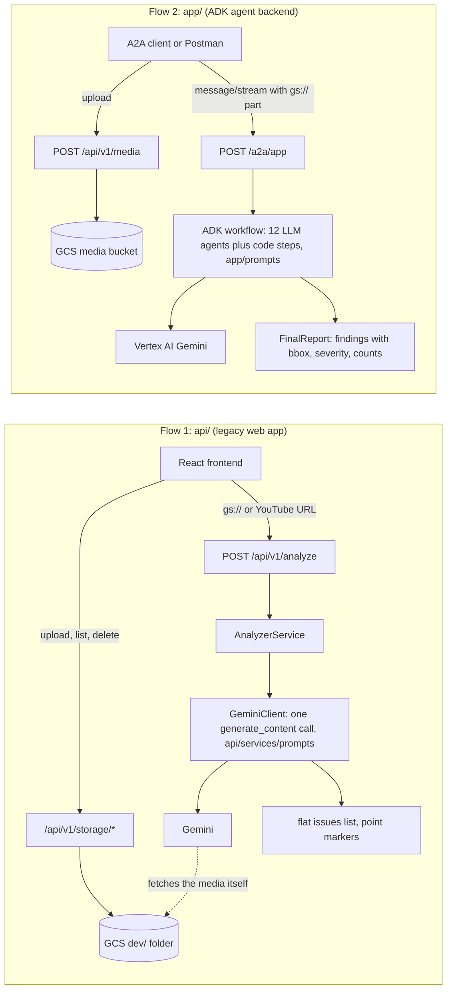
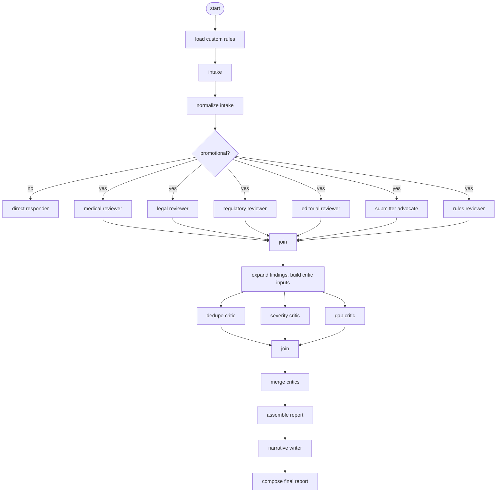
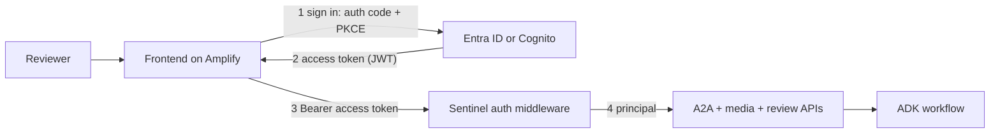

# Sentinel backend: how it works, gaps, and the plan for auth and memory

For architecture review. "Today" means branch `backend-only-deployment`, checked against the source. Sections 7 and 9 are plans; nothing in them is built. Entra ID versus Cognito is not decided.

## 1. The two flows (read this first)

The codebase has two separate backends. They share no code: `api/` never imports `app/` or ADK and never calls the ADK agents. Each has its own LLM calls and its own prompts. Where a document and the code disagree, the code is the reference.

| | Flow 1: `api/` + React | Flow 2: `app/` |
|---|---|---|
| Entry point | `api.main:app` (`Dockerfile.webapp`) | `app.fast_api_app:app` (`Dockerfile`) |
| Caller | React frontend (the frontend only calls this one) | A2A clients, Postman; the future frontend |
| How the LLM is used | Its own direct Gemini SDK call: `AnalyzerService`, then `GeminiClient`, then `models.generate_content`. One call per request, no agents, no ADK | An ADK workflow of 12 LLM agents (intake, reviewers, critics, narrative) plus code steps (section 3) |
| Prompts | `api/services/prompts/`: `video_analysis.md` and `image_analysis_single_step.md` are used; `image_analysis_without_location.md` and `find_issue_location.md` are loaded but not used by any route | `app/prompts/`: one prompt per agent |
| Media input | Upload through `/api/v1/storage/upload` (GCS `dev/` folder), then `/api/v1/analyze` with the `gs://` URI or a YouTube URL; or `/api/v1/analyze/upload` with a file. Gemini fetches the media itself | Upload through `/api/v1/media`, then send the `gs://` URI as an A2A file part. `/api/v1/media` is a later test-only addition; the original code has no upload route |
| Output | Flat `issues[]` (timestamps, severity, category, description, point `x`,`y`) plus a summary; the UI draws numbered point markers | `FinalReport`: findings with `location.bbox`, severity, confidence, discussion, suggested actions, counts |
| Deployed by this branch | No (README steps only, no Terraform) | Yes (`terraform-cloudrun/`, `deploy/deploy.ps1`) |
| Authentication | None | None |

**Flow 1 in short:** the user picks a file in the cloud-storage picker (or pastes a YouTube URL). The frontend calls `POST /api/v1/analyze` with the `gs://` or YouTube URL, a speed setting and optional custom rules. The API checks the URI and sends one Gemini request with the media and a prompt, asking for JSON in the `AnalysisResponseSchema` shape. The reply is parsed into the flat issue list, and the UI shows the list and point markers (for video, clicking an issue seeks to its timestamp). The model is chosen from settings (`GEMINI_MODEL_FAST` or `GEMINI_MODEL_POWERFUL`, both `gemini-3.8-flash` by default), through Vertex AI or an API key.

**Flow 2 in short:** section 2 below, with the workflow in section 3.

**Original code (`main`) versus what this branch added**

| | On `main` (original) | Added on `backend-only-deployment` |
|---|---|---|
| `api/` and `frontend/` | The legacy flow above | Unchanged |
| `app/` serving | `app/fast_api_app.py` with the A2A routes, ADK routes and the Console adapter (`app/app_utils/`) | `/api/v1/media` (test upload so the A2A flow can be tried with an image) and `/api/v1/feedback`, `/review`, `/save` (in-memory placeholders) |
| `app/` workflow | 13 LLM agents, including a critic merger and a synthesizer that re-typed all findings; `root` and `loop_decider` prompts present but unused | 12 LLM agents: per-request thinking level, slimmer reviewer output, critic inputs prepared in code, critics merged in code, final findings assembled in code, a short narrative writer (`processing.py`, `thinking.py`, `timing.py`) |
| Deployment | `terraform/` (Agent Runtime) | `terraform-cloudrun/` and `deploy/` (headless Cloud Run, Postman collection) |
| Tests and docs | Original tests and README | Unit tests for the new code, updated READMEs, this document |

Going forward, new work (JWT, APIs, persistence) is built on `app/`, and the frontend will be hosted on AWS Amplify. The legacy `api/` flow stays as it is. The rest of this document is about `app/` unless it says otherwise.

## 2. Flow 2 in detail: one review through `app/`

1. Client uploads the image or PDF: `POST /api/v1/media`. The file goes to the bucket under `uploads/`, the response has a `gs://` URI.
2. Client sends `POST /a2a/app` with `message/stream` (or `message/send`): a text part, a file part with the URI, and `params.metadata.thinking` (`low`, `medium`, `high`).
3. The workflow runs (section 3). Each agent's output is streamed back as an artifact.
4. The last artifact is the `FinalReport`: summary, themes, findings (severity, confidence, discussion, suggested actions, `location.bbox` normalised 0 to 1), counts by lens and severity, open questions.
5. The client then calls the placeholder APIs (review, save, feedback), which store in memory.

Typical time at `medium` is 100 s to 5 min (stalled model calls cause the slow end).

## 3. The workflow

| Step | Type | Job | Reads | Produces |
|---|---|---|---|---|
| load custom rules | code | Loads an optional rules file (`.txt` or `.md` with "rules" in the name) | artifacts | `custom_rules` |
| intake | LLM | Catalogues every reviewable element (claims, ISI, citations, visuals) with ids `C1..`, text and bbox; summarises purpose and audience | the image | `intake_findings` |
| normalize intake | code | Unique ids, valid boxes | intake | cleaned intake |
| route | code | Non-promotional input goes to the direct responder | intake | route |
| direct responder | LLM | Short plain-text answer, no review | intake | free text (no `FinalReport`) |
| medical, legal, regulatory, editorial reviewers | LLM x4 | Review through one lens each; 10 to 25 findings; list related item ids; bbox only for multi-item findings | intake catalogue | findings per lens |
| submitter advocate | LLM | Strongest honest defence of each likely flag | intake catalogue | defense brief |
| rules reviewer | LLM | Checks the custom rules; skipped (no model call) when there are none | rules, intake | findings |
| expand findings, critic inputs | code | Full finding shape, ids `F-MED-1`, confidence band, location from items; digest, duplicate candidates, coverage hints | reviewer output | critic inputs |
| dedupe critic | LLM | Groups duplicates and picks which to keep; finds cross-lens themes | digest | duplicate groups, themes |
| severity critic | LLM | Checks severity against the rubric, weighs the advocate | digest, defense | severity adjustments |
| gap critic | LLM | Finds what is missing and adds findings | digest, coverage hints | extra findings |
| merge critics | code | Combines the three critic outputs | critics | one assessment |
| assemble report | code | Drops duplicates (a named keeper is never dropped), applies severity changes, sorts, renumbers, counts | all findings, assessment | final findings |
| narrative writer | LLM | Executive summary, open questions, discussion topics only | assembled digest | narrative |
| compose | code | Builds the `FinalReport` and emits it | state | final report |

Notes:
- This is the workflow on this branch: 12 LLM agents and about 9 code steps. The original on `main` had 13 LLM agents, because the critic merger and the synthesizer were also LLM agents; they are now code and a short narrative writer. Code, not an LLM, does the mechanical work (merge, severity, ids, counts). No step gives a pass or fail verdict.
- Only `intake` receives the image (measured request sizes). The reviewer prompts say "you have the original submission attached", which is not true.
- Every LLM call gets the chosen thinking level and a per-call timeout (120, 150, 300 s) with up to 10 retries. Code steps fall back to safe defaults on error; LLM steps do not.
- The review loop (`iterate`) is dead code: the cap is 1.

## 4. What each API in `app/` is for

| Path | Purpose | Caller | Origin |
|---|---|---|---|
| `POST /api/v1/media` | Upload image or PDF, returns `gs://` URI | client before the A2A call | Added for testing |
| `POST`, `GET /api/v1/feedback`, `/review`, `/save` | Placeholders for rating, per-finding decision, saving the report (in memory) | frontend | Added placeholders |
| `GET /a2a/app/.well-known/agent-card.json` | Agent card: skills, URL, protocol versions | A2A clients | a2a-sdk |
| `POST /a2a/app` | Main entry (JSON-RPC): send, stream, get task, list tasks, cancel, resubscribe. v0.3 by default, v1.0 with header `A2A-Version: 1.0`. Push-notification and extended-card methods exist but do nothing | A2A clients | a2a-sdk |
| `POST /api/reasoning_engine`, `/api/stream_reasoning_engine` | Adapter for the Vertex AI Console playground: session and memory calls, streaming queries | Vertex Console | Original (Sentinel code) |
| `POST /run`, `/run_sse`, `WS /run_live` | ADK native run of the workflow | ADK tools | ADK |
| `/apps/{app}/users/{user}/sessions...` | ADK session create, get, list, update state, delete | ADK tools | ADK |
| `/apps/{app}/users/{user}/sessions/{id}/artifacts...` | ADK artifact save, list, load, versions, delete | ADK tools | ADK |
| `PATCH /apps/{app}/users/{user}/memory` | Add a session to the memory service | ADK tools | ADK |
| `GET /health`, `/version`, `/list-apps`, `/apps/{app}/app-info`, `POST /agent-identity/finalize` | Liveness (static `ok`), versions, list agents, agent info, OAuth consent helper | probes, ADK | ADK |
| `/docs`, `/redoc`, `/openapi.json` | Swagger; turned off with `ENABLE_API_DOCS=false` | developers | FastAPI |

The ADK native routes, the Console adapter and the A2A task routes are the ones to lock down first, because they take a caller-supplied `user_id`, `state_delta` or task id.

## 5. Where state lives

| Data | Where | Lifetime |
|---|---|---|
| Sessions (agent state) | in memory | lost on restart or deploy |
| A2A tasks and streamed artifacts | in memory, no eviction | lost on restart; grows until then |
| Uploaded files | GCS bucket `uploads/` | forever (only old versions are trimmed) |
| Placeholder review, save, feedback | in memory, capped at 1000 | lost on restart |
| Long-term memory | none | not used by the agents |

The service is pinned to one instance because of this. Follow-up messages with the same `contextId` reuse the session state, which nothing clears.

## 6. Authentication today

None in the code. The only control is the Cloud Run invoker setting: public by default (`ALLOW_UNAUTHENTICATED_INVOKE=true`), or Google IAM tokens. The service's own Google credentials (`sentinel-runtime`) are server-to-Google only (Vertex AI, GCS) and do not identify callers. No IAP or Identity Platform is configured in `terraform-cloudrun/`. The user id inside ADK is `A2A_USER_<contextId>`, where the client chooses the `contextId`, so knowing it gives access to that session. Agents do not call each other over A2A: they are steps in one in-process workflow, and A2A is only how outside callers reach it.

## 7. Authentication, authorization and isolation (Entra ID or Cognito, not decided)

Setup: the frontend runs on AWS Amplify and calls Sentinel on Cloud Run directly. Entra and Cognito are both outside Google, and Cloud Run IAM only accepts Google tokens, so Sentinel validates the token itself. Cloud Run is then public at the network level and the app is the only gate, so it must fail closed.

### Sign-in and tokens (same for both IdPs)

1. The frontend is a public client: no client secret in the browser. Use MSAL.js (Entra) or Amplify Auth (Cognito) with the authorization code flow and PKCE. Implicit flow stays off.
2. The app creates a random `code_verifier` and sends its hash (`code_challenge`) with the sign-in redirect. The IdP returns a one-time code. The app swaps the code plus the original verifier for tokens, so a stolen code is useless. MFA and Conditional Access are configured in the IdP.
3. The frontend sends the access token as `Authorization: Bearer`. The ID token is only for showing the user's name and never goes to an API. No cookies, so no CSRF exposure. Tokens stay in memory or the library's session storage, never `localStorage`.
4. Streaming uses `fetch` with the header (browser `EventSource` cannot set headers). The token is checked when the request starts; a review lasts minutes, shorter than the token lifetime.

### Verify the token in Sentinel (new `app/auth/`)

Checks on every request: signature with the IdP's public keys (JWKS, cached, refreshed once on an unknown `kid`); RS256 only (reject `none` and HS256); `iss` exact; `aud` is this API; `exp` and `nbf` with at most 60 s skew; permission present. Then build a principal `{user id, tenant, roles, client id}`. Settings: `OIDC_ISSUER`, `OIDC_JWKS_URI`, `OIDC_AUDIENCE`, and the claim names, so either IdP works by configuration.

| | Entra ID | Cognito |
|---|---|---|
| Issuer | `https://login.microsoftonline.com/<tenant>/v2.0` | `https://cognito-idp.<region>.amazonaws.com/<pool>` |
| Keys | `https://login.microsoftonline.com/<tenant>/discovery/v2.0/keys` | `<issuer>/.well-known/jwks.json` |
| Audience | API app id (`aud`) | access token has `client_id`, no `aud` |
| Permissions | `scp`, `roles` | `scope`, `cognito:groups` |
| User key | `oid` + `tid` | `sub` |
| Extra checks | `tid` is your tenant; `azp` is the frontend client | `token_use` is `access`; `client_id` is the frontend app client |
| Setup gotchas | register the frontend as "Single-page application"; set `accessTokenAcceptedVersion: 2` on the API; assign app roles to groups (avoids group overage) | app client without secret, PKCE on; groups from a federated Entra sign-in need a pre token generation Lambda |
| Machine callers | client credentials | client credentials with resource-server scopes |

### Groups and roles: no users added in Google Cloud

The identity provider owns who has access. Adding a user to a group in Entra or Cognito is the only step. Sentinel and Google Cloud keep no user list and no per-user IAM.

1. The token carries the user's roles or groups. Sentinel maps them to its own roles with one small setting (`ROLE_CLAIM` and `ROLE_MAP`, for example `Sentinel.Reviewer` to `reviewer`, `Sentinel.Admin` to `admin`). A new group later is a config change; a new user is nothing.
2. The first request from a user creates their records (just in time), keyed by `oid` + `tid` (Entra) or `sub` (Cognito).
3. No valid token or no mapped role gives 401 or 403.

Entra: define app roles on the API registration and assign groups to those roles. The token then has a `roles` claim with the role names. Do not depend on the raw `groups` claim: a JWT carries at most 200 groups, and above that Entra sends an overage pointer instead of the list, so the app would have to call Microsoft Graph. App roles avoid that and give stable names instead of group GUIDs. Check licensing first: assigning groups to app roles usually needs Entra ID P1.

Cognito: groups live in the user pool and appear in `cognito:groups` in both the ID and access tokens. Cognito does not copy groups from a federated Entra sign-in into `cognito:groups`. For those users, map the Entra role or group claim to a user pool attribute and use a pre token generation Lambda (event version 2 or later, which needs the Essentials or Plus plan) to set `cognito:groups` or a custom claim in the access token.

Trade-offs:
- A group change takes effect when the next access token is issued, not instantly. Keep access tokens short-lived (Cognito sets validity per app client; for Entra check the token lifetime and continuous access evaluation options).
- Validation is local with cached keys: no call to Entra, Cognito or Graph per request, and nothing per user to sync. It works the same on one instance or many, and as users grow.

### Lock down the routes

- Everything needs a valid token except `/health` (and the docs when `ENABLE_API_DOCS=true`). A test walks `app.routes` and fails if a route is neither protected nor on the allowlist.
- Shrink the surface. The ADK native routes (`/apps/...`, `/run`, `/run_sse`, `/run_live`, `/list-apps`, `/version`, `/agent-identity/finalize`) and the Console adapter accept any `user_id` and `state_delta`. Remove them in deployed builds the same way `fast_api_app.py` already removes the docs routes, and keep only the A2A endpoint with its agent card, `/api/v1/media`, review, save, feedback and `/health`.
- CORS: set `ALLOW_ORIGINS` to the exact Amplify origin (ADK returns 403 to browsers from other origins). No `*`.
- The agent card declares the bearer scheme (`securitySchemes`, `security`) so A2A clients know a token is needed. It stays public.

### Sign-in page on Amplify

Amplify Hosting only serves the static React build. The sign-in page is part of the frontend and talks to the identity provider; Sentinel only receives the resulting bearer token.

- **Entra directly (MSAL):** `@azure/msal-react` with `loginRedirect` (authorization code + PKCE). Register the frontend as "Single-page application" with the Amplify domains as redirect URIs, and request the Sentinel API scope. MSAL keeps tokens in `sessionStorage` by default (cleared when the tab closes). SPA refresh tokens last about 24 hours, after which the user signs in again; access tokens last about an hour.
- **Cognito (Amplify Auth):** Cognito managed login. Entra can be added to the user pool as an OIDC provider (`externalProviders.oidc` with `clientId`, `clientSecret`, `issuerUrl`), sign-in starts with `signInWithRedirect`, and `callbackUrls` and `logoutUrls` list the Amplify domains. Check the token storage default and PKCE use in the Amplify version you install; the documentation page I read does not say.
- **Hosting hardening:** put security headers (CSP, HSTS, `X-Frame-Options`) in `customHttp.yml` in the repo root (it overrides the console setting), add a rewrite so every route serves `index.html`, and give each environment its own Amplify branch and domain with its own redirect URIs and app registration or app client.

Recommendation: if your users already live in Entra, go direct with MSAL. It has one service fewer, groups arrive as app roles, and no Lambda is needed. Choose Cognito if you must broker several identity providers, serve external users, or want the AWS-side tooling.

### Pass the user into the workflow

The installed a2a-sdk builds each call's user from the Starlette request: its default context builder uses `request.scope["user"]`, and that user's `display_name` becomes `user_name` (`a2a/server/routes/common.py:49-85`). The auth middleware sets `scope["user"]` to the principal, with `display_name` set to a stable id (`<tid>:<oid>` for Entra, `sub` for Cognito). Then:
- ADK uses it as the session `user_id` (`google/adk/a2a/converters/request_converter.py:67-77`), so another user's `contextId` resolves to a different session;
- the A2A task store keeps tasks per user, so `GetTask` and `ListTasks` stop returning other users' tasks.

Confirm with a two-user test before relying on it. If the default builder is not enough, pass a `context_builder` in `app/app_utils/a2a.py`.

### Authorization and isolation

- Roles come from the token (see "Groups and roles") and are checked per route (review, save, admin actions).
- Uploads go under `uploads/<tenant>/<user>/<random>`. A file part's `gs://` URI is accepted only inside the caller's prefix; other schemes and hosts are rejected. This closes the unvalidated-URI gap.
- Review, save and feedback records are keyed by principal and tenant.
- `user_id` and `state_delta` are never taken from the client.
- One audit log line per request: principal, route, session, outcome. No document content.

### Agent-to-agent

- Agents calling Sentinel authenticate as machine clients (client credentials). Their principal carries a `client_id` and scopes instead of a user.
- Sentinel makes no outbound agent calls today. If that changes, use Entra on-behalf-of where the user context must flow, and client credentials otherwise (Cognito has no on-behalf-of).
- Hand-offs between Sentinel's own agents stay in-process; no tokens are involved.

### Deployment and other controls

- Set `ALLOW_UNAUTHENTICATED_INVOKE=true` once the token check is on (IAM cannot validate Entra or Cognito tokens). Add `OIDC_*` and `AUTH_ENABLED` to `deploy.env`, `deploy/deploy.env.example` and `terraform-cloudrun/variables.tf`. `AUTH_ENABLED` defaults to `false` so the test deployment keeps working; when it is `true`, a missing or invalid setting stops the app from starting.
- Add rate limiting and a WAF in front (Cloud Armor needs a load balancer), request size limits, and short access-token lifetimes.
- Amplify headers: CSP, HSTS, `X-Frame-Options`. No secrets in the frontend. No long-lived keys: the service uses its service account only.
- Alerts on 401 and 403 spikes; log retention. CMEK and a regional Vertex location if data residency matters.
- Postman: add a token step (the `token` variable already exists).

### Alternative considered: IAP with Workforce Identity Federation

Google IAP can accept Entra users through Workforce Identity Federation and grant access to a whole Entra group (`roles/iap.httpsResourceAccessor` on a `principalSet` for the group), so it also needs no per-user setup in Google Cloud. It is not chosen because Cloud Run support is in Preview; programmatic access is limited to Google service accounts, so Postman, other agents and Entra or Cognito bearer tokens could not call the API; each IAP-protected app supports one pool with one provider; and a browser app on another domain would depend on IAP's cookie sign-in and CORS settings. Revisit it only if every caller is a browser user in Entra. An IAP design built on Google Workspace identities does not fit Entra or Cognito.

### Verification

- Unit tests with locally signed JWTs: valid, expired, not yet valid, wrong issuer, wrong audience, wrong tenant, wrong algorithm, `alg=none`, unknown `kid`, missing scope or role.
- The route-coverage test above.
- Isolation tests: user A cannot read B's session, task or upload.
- The existing 436 unit tests stay green with `AUTH_ENABLED=false`.
- Postman run against local and Cloud Run with a real token from the chosen IdP.

### Order of work and rollback

(1) verifier and settings; (2) route lock and surface shrink; (3) user passed into ADK; (4) roles, upload prefixes, audit; (5) deployment variables, docs, Postman; (6) persistence (section 9). One commit per step with a tag after each passes. `AUTH_ENABLED` stays `false` until step 5 is deployed and tested, so every step can be reverted without breaking the test deployment.

## 8. Gaps

| # | Gap | Evidence | Sev |
|---|---|---|---|
| 1 | No authentication or authorization; public by default, ingress open | `terraform-cloudrun/main.tf`, `app/fast_api_app.py` | P0 |
| 2 | ADK routes and the Console adapter take any `user_id` and `state_delta`; callers can read or delete any session or artifact and inject state such as `custom_rules` | `google/adk/cli/api_server.py`, `reasoning_engine_adapter.py` | P0 |
| 3 | All unauthenticated callers share one task owner, so any caller can list or fetch every task | a2a-sdk in-memory store | P0 |
| 4 | `gs://` and URL file parts are not validated; the agent can be pointed at any bucket object or web URL | ADK part converter | P0 |
| 5 | No untrusted-content framing in prompts; document text reaches every agent; `custom_rules` unbounded | `app/prompts/*.md` | P0 |
| 6 | Uploads never deleted, no CMEK; model location defaults to `global` (overrides Terraform) while the bucket is `us-central1` | `main.tf`, `app/agent.py:107` | P1 |
| 7 | Sessions and tasks in memory, one instance, lost on deploy; tasks never evicted | `fast_api_app.py:61`, `services.py` | P1 |
| 8 | No overall deadline (a call can retry for about 56 min at `high`), no shared rate limit, 20 concurrent runs mean about 120 parallel model calls; about 11% of calls stall | `agent.py`, `thinking.py` | P1 |
| 9 | LLM steps are not fail-soft: one failed reviewer fails the run (parallel behaviour not verified) | `agent.py` | P1 |
| 10 | Reviewer prompts claim an attached image they do not receive; intake prompt has no rule for `is_promotional`; routing uses substring matching | `medical_reviewer.md:6`, `agent.py:272` | P1 |
| 11 | Dead review loop and unused fields (`confidence_concerns`, `advocate_weighed`, `id_map`) | `agent.py:538`, `schemas.py` | P2 |
| 12 | `/health` is static, no liveness probe, 10 s shutdown grace; cancel and client disconnect may not stop model spend (not verified) | ADK, `main.tf` | P1 |
| 13 | No metrics, traces, alerts or audit log; runtime account lacks trace and metric roles | `main.tf` | P1 |
| 14 | Container runs as root with dev dependencies and an unpinned base image; no scan or tests in the build; `run_outputs/` is uploaded with the source | `Dockerfile`, `cloudbuild.yaml`, `.gcloudignore` | P1 |
| 15 | Tests do not cover an image or a full review over A2A (the only A2A e2e test sends "Hi!"); 436 unit tests cover the code steps | `tests/integration/test_server_e2e.py` | P1 |
| 16 | `GET /api/v1/save`, `/review`, `/feedback` return everyone's data; `/list-apps` also lists `api` | `app/routes/dummy.py` | P1 |
| 17 | Docs drift: retry count in the deploy README, video support claim, stale `agents-cli-manifest.yaml` | READMEs | P2 |

## 9. Memory and persistence plan

1. Sessions: set `SESSION_SERVICE_URI` to a database or Vertex session service.
2. A2A tasks: replace the in-memory task store with the a2a-sdk database store.
3. State per submission: reset or namespace the session state so a follow-up is not treated as a refinement of the previous review.
4. Raise `max_instances` above 1 only after steps 1 and 2.
5. Long-term memory: do not add unless there is a stated need, and decide retention first because the content is regulated promotional material.
6. Artifacts: keep GCS (`LOGS_BUCKET_NAME`) with the per-user prefix from section 7.
7. Replace the placeholder review, save and feedback APIs with database-backed ones scoped to the principal.

## 10. Next steps and open decisions

Order of work is in section 7 (verifier, route lock, user into ADK, roles and uploads, deployment, then persistence in section 9), then quotas, deadline, observability, container hardening, and the prompt and doc fixes from the gap table. One small commit per step.

Open decisions: Entra ID or Cognito (and, if Cognito, native users or federated from Entra); one tenant or many; Postgres (Cloud SQL) or Vertex sessions for persistence; whether any long-term memory is wanted.

Not yet verified at runtime: what happens when one parallel reviewer fails, whether cancel stops the running workflow, whether the shutdown signal reaches uvicorn through `uv run`, whether critics receive the full reviewer output as their user message, and the two-user isolation test in section 7.

## Sources

- [Entra group overage and the 200-group JWT limit](https://learn.microsoft.com/en-us/troubleshoot/entra/entra-id/app-integration/get-signed-in-users-groups-in-access-token)
- [Cognito pre token generation Lambda trigger](https://docs.aws.amazon.com/cognito/latest/developerguide/user-pool-lambda-pre-token-generation.html)
- [Cognito user pool groups](https://docs.aws.amazon.com/cognito/latest/developerguide/cognito-user-pools-user-groups.html)
- [Cognito OIDC identity providers (including Entra)](https://docs.aws.amazon.com/cognito/latest/developerguide/cognito-user-pools-oidc-idp.html)
- [Amplify Auth external identity providers](https://docs.amplify.aws/react/build-a-backend/auth/concepts/external-identity-providers/)
- [Amplify Hosting custom headers](https://docs.aws.amazon.com/amplify/latest/userguide/custom-headers.html)
- [MSAL.js token caching](https://learn.microsoft.com/en-us/entra/msal/javascript/browser/caching) and [MSAL.js token lifetimes](https://learn.microsoft.com/en-us/entra/msal/javascript/browser/token-lifetimes)
- [IAP with Workforce Identity Federation](https://docs.cloud.google.com/iap/docs/use-workforce-identity-federation)
